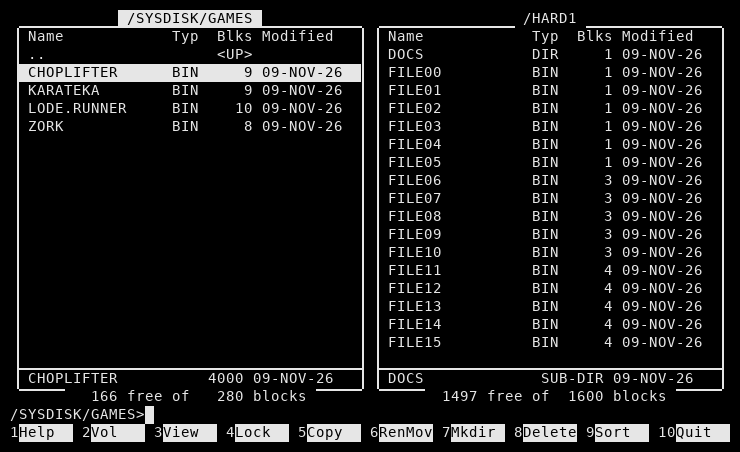

# YANC – Yet Another Norton Commander for the Apple IIc

A two-panel, Norton Commander style file manager for ProDOS 8, written in 65C02 assembly.
80 columns, MouseText frames, and a function-key bar (keys `1`–`0` stand in for F1–F10).
The focus is on feeling like the original NC, with fast drive switching: press `2`, pick a disk, done.



## Requirements
- Apple IIc, enhanced Apple IIe with an 80-column card, or Apple IIgs (65C02 + 80 columns + MouseText)
- ProDOS 8 (tested with 1.9 and 2.4)

## Download
- [`release/YANC.po`](release/YANC.po) – 140K ProDOS disk image containing `YANC.SYSTEM`
- [`release/YANC.SYSTEM`](release/YANC.SYSTEM) – the program itself (ProDOS type `SYS` / `$FF`, aux type `$2000`)

> **Note: `YANC.po` is not a bootable disk.** It holds only `YANC.SYSTEM` – there is no `PRODOS` file on it
> (ProDOS is Apple's software and is not redistributed here).
> Copy `YANC.SYSTEM` to a disk or hard drive that already boots ProDOS, then run it from there.

## Getting started
1. Boot any ProDOS 8 disk (ProDOS 2.4.x from [prodos8.com](https://prodos8.com) is recommended).
2. Copy `YANC.SYSTEM` from `YANC.po` to your boot disk or hard drive – for example with Copy II Plus,
   ProDOS Filer, or [CiderPress II](https://ciderpress2.com) / [AppleCommander](https://github.com/AppleCommander/AppleCommander) on a modern computer.
   Make sure it keeps file type `SYS` and aux type `$2000`.
3. Run it: select it in Bitsy Bye, or type `-YANC.SYSTEM` at the BASIC prompt.
4. Optional – start YANC automatically at boot: ProDOS runs the first `*.SYSTEM` file in the volume directory.
   In YANC, put the cursor on `YANC.SYSTEM` in the volume root and press `4` then `B`.

Alternatively, make `YANC.po` itself bootable by copying a `PRODOS` file onto it.

## Keys
| Key | Action |
|---|---|
| Up / Down | Move cursor (Open-Apple + arrow: first / last) |
| Left / Right | Page up / down |
| Tab | Switch panel |
| Return | Enter directory · run SYS · run BAS/BIN via BASIC.SYSTEM · view TXT |
| Esc / Delete | Parent directory |
| Space | Tag / untag · `+` tag all · `-` untag all · `*` invert |
| A–Z | Jump to name |
| Ctrl-R / Ctrl-S | Re-read disks / swap panels |
| `1` Help | Key summary |
| `2` Vol | Choose a volume (all online drives) |
| `3` View | Text / hex viewer |
| `4` Lock | `L` lock · `U` unlock · `B` make this `.SYSTEM` file boot first |
| `5` Copy | Copy to the other panel (overwrite: Yes / No / All) |
| `6` RenMov | Rename, or move to the other panel / any path |
| `7` Mkdir | Create directory |
| `8` Delete | Delete (asks before deleting locked files) |
| `9` Sort | Sort by name / type |
| `0` Quit | Quit to ProDOS |

Locked files are shown with `*` after the name, like `CATALOG`.
Copy keeps file type, aux type, access and dates. Directories are not copied recursively.

### Extended (forked) files
GS/OS files with a resource fork (storage type 5 – most of a System 6 disk) are marked with `+` after the name.
ProDOS 8 itself can't open or delete them, so YANC handles them at block level:
**copy, move and delete work on them**, with both forks and the Finder info kept.
ProDOS still does all block allocation – each fork is written to (or freed through) a temporary file
`YANCTMP.0` / `YANCTMP.1` in the same directory, whose directory entry YANC then takes over.
If a copy fails (for example disk full), the temporary files are removed again.
Viewing (`3`) shows only an error for these files.

## Building
Needs [cc65](https://cc65.github.io/) (`ca65`, `ld65`) and Python 3:
```
./build.sh
```
This writes `release/YANC.SYSTEM` and `release/YANC.po`.

## Tests
`tests/` contains a small harness: a 65C02 CPU ([py65](https://github.com/mnaberez/py65)), the IIc 80-column
screen memory, and a simulated ProDOS MLI backed by host folders (plus real `.po` images for block I/O).
`p8img.py` is a second MLI simulation working on real ProDOS images with ProDOS 8 rules (OPEN and DESTROY
refuse extended files), with a checker for the whole volume (every block used once, bitmap and file counts right);
`t8.py` uses it to test extended files.
```
pip install py65 pillow
cd tests && python3 t2.py
```
`t7.py` (boot-order test) also uses [AppleCommander](https://github.com/AppleCommander/AppleCommander) to verify the disk image.

## Memory map
| Range | Use |
|---|---|
| `$0800–$0FFF` | variables |
| `$1000–$12FF` | program loader (only while launching) |
| `$2000–$4FFF` | code and data |
| `$5000–$6FFF` | directory entries of both panels (128 each) |
| `$7000–$77FF` | ProDOS file buffers |
| `$7C00–$7DFF` | directory block buffer |
| `$8000–$BBFF` | copy / view buffer (`$B400–$B9FF`: index and extended key blocks) |

## Credits
Inspired by Norton Commander (John Socha) and by the many great Apple II file managers that came before.

## License
MIT – see [LICENSE](LICENSE).
